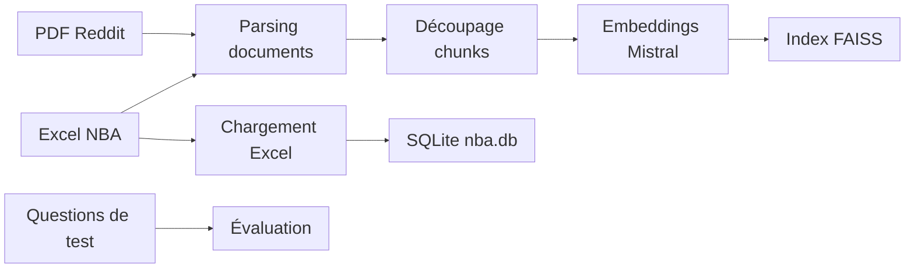

# Préparation des données

Des sources hétérogènes sont transformées en deux supports interrogeables : un index vectoriel FAISS et une base SQLite.

## Sources utilisées

- Discussions Reddit NBA en PDF. (autres documents exploitables par le loader)
- Classeur Excel `regular NBA.xlsx`.
- Cas d’évaluation manuels en YAML.

## Chaîne de préparation

## Index vectoriel

| Étape | Fonctions / outils |
| --- | --- |
| Parsing documents | `load_and_parse_files(...)`  `PyMuPDF`, `EasyOCR`,  `pandas` |
| Découpage chunks | `VectorStoreManager._split_documents_to_chunks(...)`  `RecursiveCharacterTextSplitter`  `chunk_size=1500`, `chunk_overlap=150`, `add_start_index=True` |
| Embeddings Mistral | `VectorStoreManager._generate_embeddings(...)`  `mistral_client.embeddings.create(...)`  modèle `mistral-embed`, batch `32`, vecteurs `1024` dimensions |
| Index FAISS | `VectorStoreManager.build_index(...)`  `faiss.normalize_L2(...)`, `faiss.IndexFlatIP`  similarité cosinus via produit scalaire, `302` chunks indexés |

`src/llmeval/scripts/indexer.py` orchestre ces étapes à partir du dossier `inputs/`.

Sorties principales :

- `vector_db/faiss_index.idx` ;
- `vector_db/document_chunks.pkl`.

## Base structurée

| Étape | Fonctions / outils |
| --- | --- |
| Lecture Excel | `read_teams(...)`, `read_features(...)`, `read_players(...)`  `pandas.read_excel(...)`  feuilles `Equipe`, `Dictionnaire des données`, `Données NBA` |
| Normalisation | `normalize_column_name(...)`, `clean_column_label(...)`  renommage des colonnes NBA vers des noms SQL stables |
| Validation | `TeamImport`, `FeatureImport`, `PlayerImport`  `Pydantic`, `extra="forbid"`, `45` colonnes joueurs attendues |
| Création SQLite | `recreate_database(...)`, `create_tables(...)`  `SQLAlchemy ORM`, tables `teams`, `features`, `players` |
| Insertion + contrôles | `insert_data(...)`, `run_checks(...)`  contrôle des volumes, équipes inconnues, doublons joueur/équipe |

`src/llmeval/ingestion/load_excel_to_db.py` orchestre le chargement du classeur `inputs/regular NBA.xlsx`.

Sortie principale :

- `database/nba.db` : `30` équipes, `45` features, `569` joueurs.

## Cas d’évaluation

| Champ | Rôle |
| --- | --- |
| `id` | Identifiant stable du cas |
| `category` | Type de question évaluée |
| `source_type` | Source principale : Reddit ou Excel |
| `question` | Question envoyée au système |
| `reference_answer` | Réponse attendue pour l’évaluation |
| `expected_behavior` | Comportement cible : répondre, synthétiser, refuser |
| `expected_sources` | Sources qui doivent justifier la réponse |
| `evidence_notes` | Notes de validation manuelle |

| Cas | Catégorie | Question |
| --- | --- | --- |
| `Q01` | `qualitative_simple` | Qu'est-ce qui rend Julius Randle plus convaincant dans ces playoffs selon les commentaires ? |
| `Q02` | `qualitative_simple` | Pourquoi les Timberwolves impressionnent-ils certains fans dans le fil Reddit ? |
| `Q03` | `qualitative_comparison` | Quelles équipes reviennent le plus souvent comme surprises positives en playoffs, et pour quelles raisons ? |
| `Q04` | `qualitative_complex` | Pourquoi les Pacers peuvent-ils être sous-estimés par le public national selon Reddit ? |
| `Q05` | `qualitative_noisy` | Franchement, OKC-Indiana en Finales, c'est vraiment le truc soporifique que certains annoncent ? |
| `Q06` | `historical_analysis` | Sur quoi repose l'argument statistique en faveur de Reggie Miller en playoffs ? |
| `Q07` | `historical_qa` | Une équipe NBA a-t-elle déjà eu l'avantage du terrain seulement à partir des Finales ? |
| `Q08` | `quantitative_excel` | Parmi les joueurs avec au moins 300 tirs à trois points tentés, qui a le meilleur pourcentage ? |
| `Q09` | `quantitative_excel` | Quel joueur possède le plus grand total de rebonds dans la table des joueurs ? |
| `Q10` | `quantitative_limit` | Qui a le meilleur pourcentage à trois points sur ses cinq derniers matchs ? |

`eval_cases/nba_eval_cases.yaml` sert de contrat d’évaluation reproductible.
