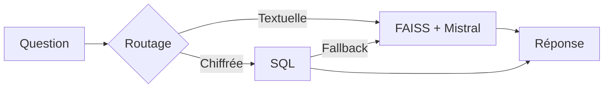

# Pipeline RAG

Le système choisit entre deux chemins : recherche vectorielle pour les questions textuelles, SQL pour les questions chiffrées.

## Deux types de questions

- **Questions qualitatives** : synthèse de discussions Reddit NBA.
- **Questions quantitatives** : calculs sur les statistiques NBA structurées.
- **Questions limites** : données absentes ou granularité insuffisante.

## Routage hybride

## Chemin FAISS

| Étape | Fonctions / outils |
| --- | --- |
| Embedding question | `mistral_client.embeddings.create(...)`  modèle `mistral-embed` |
| Recherche FAISS | `faiss.normalize_L2(...)`, `index.search(...)`  `SEARCH_K=5`, similarité cosinus |
| Contextes retrouvés | `RetrievedContext.from_search_result(...)`  texte, source, score, métadonnées |
| Génération réponse | `RagAgent.answer(...)`  `Pydantic AI`, `MistralModel`, `StructuredRagOutput`  `mistral-small-latest` : `119B` paramètres, `6.5B` actifs, contexte `256k` tokens  température `0.1`, max tokens `1200` |
| Sortie structurée | `RagAnswer`, `RagAnswerVisible`  réponse, sources utilisées, confiance, contexte insuffisant |

## Chemin SQL

| Étape | Fonctions / outils |
| --- | --- |
| Détection question chiffrée | `should_try_sql(...)`  mots-clés + métriques NBA : `pts`, `reb`, `3p%`, `ast`, `classement`, `moyenne` |
| Génération requête SQL | `create_nba_sql_agent(...)`, `create_sql_agent(...)`  `LangChain`, `ChatMistralAI`, modèle `mistral-small-latest`  guide `database/sql_agent_guide.md`, `top_k=10`  `max_iterations=12`, timeout `30s` |
| Exécution SQL | `create_nba_sql_database(...)`, `ReadOnlySQLDatabase.run(...)`  tables `players`, `teams`, `features`, `sample_rows_in_table_info=2`  requêtes autorisées : `SELECT` et `WITH` uniquement |
| Capture de la trace SQL | `intermediate_steps` LangChain  récupère la requête exécutée, le résultat SQL observé et les outils appelés |
| Classification résultat | `SqlToolResult`  `success`, `ambiguous`, `missing_data`, `missing_sql_evidence`, `sql_error`, `timeout` |
| Reformulation finale | `ChatMistralAI` appelé directement après SQL  reformule uniquement à partir de la question, de la requête SQL et du résultat observé  température `0`, reformulation max `300` tokens |
| Fallback FAISS | `SQL_FALLBACK_TO_FAISS=True`  si SQL échoue, retour au chemin vectoriel |
