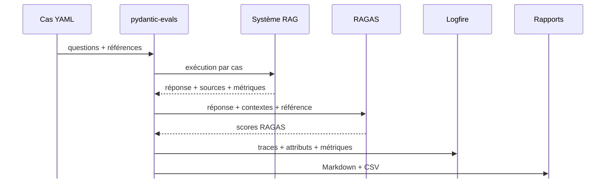

# Évaluation RAGAS et Logfire

<div class="lead-callout">
L’évaluation combine un jeu de questions contrôlé, une exécution automatisée et des traces observables dans Logfire.
</div>

## Objectif

- Mesurer la qualité des réponses du système.
- Identifier les cas où le contexte est mal retrouvé.
- Suivre les coûts, latences et appels modèles.
- Comparer les versions du pipeline dans le temps.

## Chaîne d’évaluation



## Rôle de pydantic-evals

- Charge les cas depuis `eval_cases/nba_eval_cases.yaml`.
- Exécute la tâche RAG ou hybride pour chaque question.
- Attache les entrées, sorties, références et métadonnées.
- Centralise les métriques produites pendant l’évaluation.

## Métriques RAGAS

| Métrique | Question posée |
| --- | --- |
| `faithfulness` | La réponse reste-t-elle fidèle aux contextes ? |
| `answer_relevancy` | La réponse répond-elle bien à la question ? |
| `context_precision` | Les contextes retrouvés sont-ils utiles ? |
| `context_recall` | Les contextes couvrent-ils les éléments attendus ? |

### Détail calcul métrique RAGAS

| Métrique | Calcul |
| --- | --- |
| `faithfulness` | <ol><li>RAGAS prend la question, la réponse générée et les contextes retrouvés.</li><li>Un juge LLM **découpe la réponse en affirmations factuelles**.</li><li>Puis vérifie si chaque affirmation est **présente ou déductible à partir des contextes**.</li><li>Le score reflète la proportion d'affirmations justifiables par les contextes.</li></ol> |
| `answer_relevancy` | <ol><li>RAGAS prend la question initiale et la réponse générée.</li><li>Un juge LLM **génère plusieurs questions** auxquelles la réponse pourrait répondre.</li><li>Ces questions générées sont **comparées à la question initiale** via embeddings.</li><li>Le score reflète si la réponse répond bien à l'intention de la question.</li></ol> |
| `context_precision` | <ol><li>RAGAS prend la question, la réponse de référence et les contextes retrouvés.</li><li>Un juge LLM vérifie **si chaque contexte est utile pour répondre** à la question.</li><li>Les contextes sont évalués dans l'ordre où ils ont été retrouvés.</li><li>Le score reflète si les premiers chunks sont pertinents plutôt que bruités.</li></ol> |
| `context_recall` | <ol><li>RAGAS prend la question, la réponse de référence et les contextes retrouvés.</li><li>Un juge LLM identifie les **informations nécessaires dans la réponse de référence**.</li><li>Puis vérifie si ces informations sont **présentes ou déductibles à partir des contextes**.</li><li>Le score reflète si les chunks couvrent bien les éléments attendus.</li></ol> |

## Fonction d'évaluation RAGAS

| Étape | Fonctions / outils |
| --- | --- |
| Chargement des cas | `load_eval_cases(...)` <br>lit `eval_cases/nba_eval_cases.yaml` et valide les champs avec Pydantic |
| Construction dataset | `build_hosted_eval_dataset(...)`, `Case(...)` <br>associe question, réponse attendue, sources et métadonnées |
| Ajout évaluateur | `with_ragas_evaluator(...)` <br>attache `RagasEvaluator` au dataset `pydantic-evals` |
| Préparation RAGAS | `RagasEvaluator.__post_init__(...)` <br>initialise `MistralRagasLLM`, `MistralRagasEmbeddings` et les 4 métriques |
| Scoring par cas | `RagasEvaluator.evaluate(...)` <br>utilise question, réponse générée, contextes retrouvés et référence |
| Scoring par métrique | `_score_metric(...)` <br>mesure score, durée, tokens, appels juge et embeddings |
| Cas SQL | `_sql_contexts(...)` <br>construit un contexte synthétique avec la requête exécutée et le résultat SQL |
| Export résultats | `write_reports(...)` <br>génère un rapport Markdown et un CSV détaillé |

## Observabilité Logfire

- Versions dataset, prompts.
- Modèle utilisé.
- Stratégie de retrieval.
- Sources retrouvées et utilisées.
- Scores RAGAS.
- Tokens, latence et appels API.

Lien consultable : [dataset Logfire NBA RAG](https://logfire-eu.pydantic.dev/olivier-binder/starter-project/evals/nba_rag_eval_10_short_answers?sort_by=created_at&sort_order=desc)

## Limite actuelle


!!! warning "RAGAS et SQL"
    RAGAS est pertinent pour évaluer une réponse RAG textuelle avec des contextes récupérés.

    Il n’est pas conçu pour évaluer directement du text-to-SQL ou une réponse SQL pure.

    Quand une réponse SQL est retenue, le pipeline construit donc un contexte synthétique avec la requête exécutée et le résultat SQL. Cette adaptation permet de calculer les métriques RAGAS, mais elle ne remplace pas une évaluation SQL dédiée : résultat attendu structuré, comparaison des valeurs, gestion des tolérances et cas de refus.

| Champ du contexte RAGAS | Valeur utilisée dans le cas SQL |
| --- | --- |
| `text` | Un contexte synthétique contenant la question traitée, la requête SQL exécutée, le résultat SQL observé et les sources Excel associées. |
| `score` | `1.0`, car le contexte n'est pas issu d'un classement FAISS mais d'une requête SQL retenue. |
| `source` | La feuille Excel correspondant aux tables utilisées : `Données NBA` pour `players`, `Equipe` pour `teams`, `Dictionnaire des données` pour `features`. |
| `metadata` | `retrieval_type = "sql"` pour distinguer ce contexte d'un chunk FAISS dans les exports et traces. |

Exemple de `text` transmis à RAGAS :

```text
Question SQL traitee: ...
Requete SQL executee: SELECT ...
Resultat SQL: [...]
Sources: regular NBA.xlsx (Feuille: Données NBA)
```
