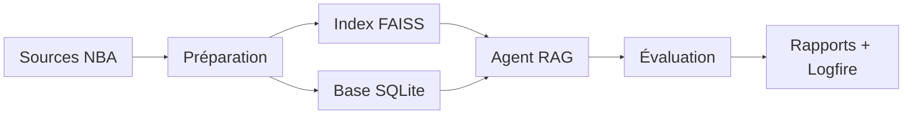

# Mission : évaluer un LLM avec un système RAG

Construire un prototype capable de répondre à des questions sur une saison de NBA, puis mesurer la qualité des réponses avec une méthodologie reproductible.

## Objectif de la soutenance

- Expliquer le fonctionnement du système RAG.
- Montrer comment l’évaluation est orchestrée et observée.
- Présenter le repo Git.

## Vue générale

## Stack principale

## Livrables au sein du repo

| Livrable attendu | Dossiers, fichiers |
| --- | --- |
| Environnement reproductible | `pyproject.toml`  `uv.lock`&nbsp; |
| Préparation des données | `src/llmeval/scripts/indexer.py` --> Orchestrateur  `src/llmeval/utils/data_loader.py`&nbsp;&nbsp; `src/llmeval/utils/vector_store.py`&nbsp; `vector_db/`&nbsp; `src/llmeval/ingestion/`&nbsp; `database/nba.db`&nbsp; |
| Mise en place du RAG | `src/llmeval/utils/rag_agent.py`&nbsp;&nbsp; `src/llmeval/utils/sql_tool.py`&nbsp;&nbsp;|
| Évaluation et tests | `eval_cases/` `src/llmeval/scripts/evaluate.py`&nbsp;&nbsp;&nbsp; `src/llmeval/utils/eval_schemas.py`&nbsp; |
| Observabilité et rapports | `src/llmeval/utils/logfire_datasets.py`&nbsp; `reports/` |
